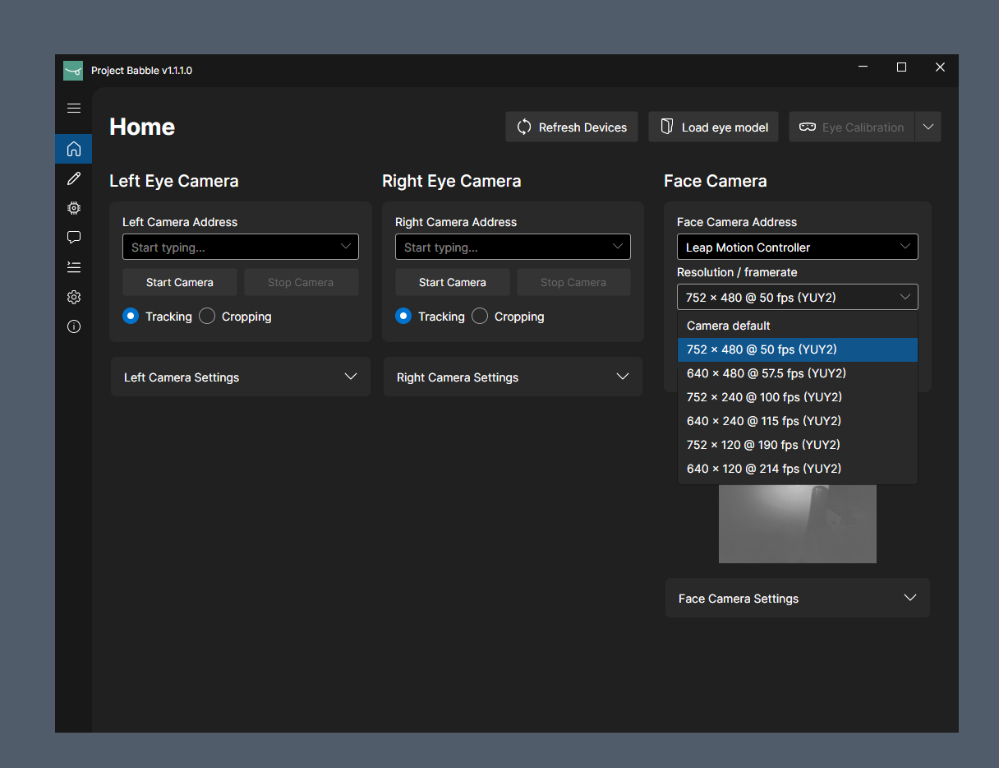

This is a fork of babble [read original readme](https://github.com/Project-Babble/Baballonia/blob/main/README.md)

I pointed claude to make a new option under every UVC camera, the ability to change resolutions and framerate.  
The point is that different cameras work better at different framerates and resolutions, something that the original babble project does not give you.

Below the face camera address, a new dropdown option has been added.  
This allows you to choose all supported framerates and resolutions combos that the camera advertises.